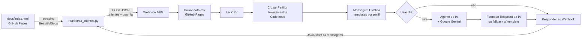
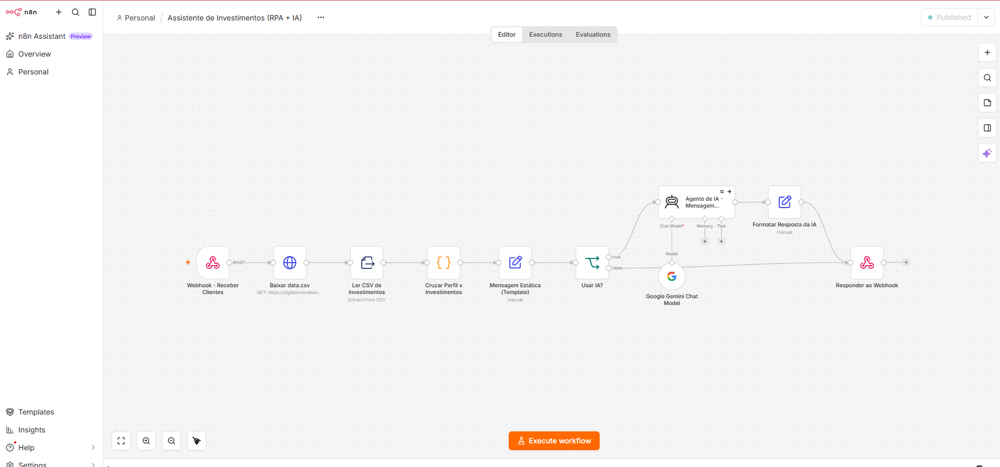
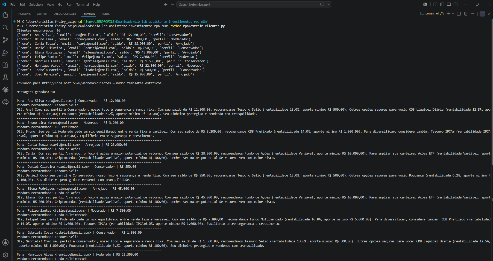
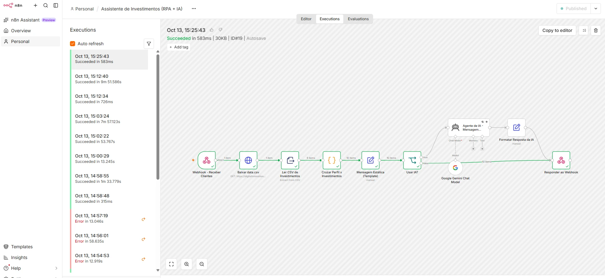
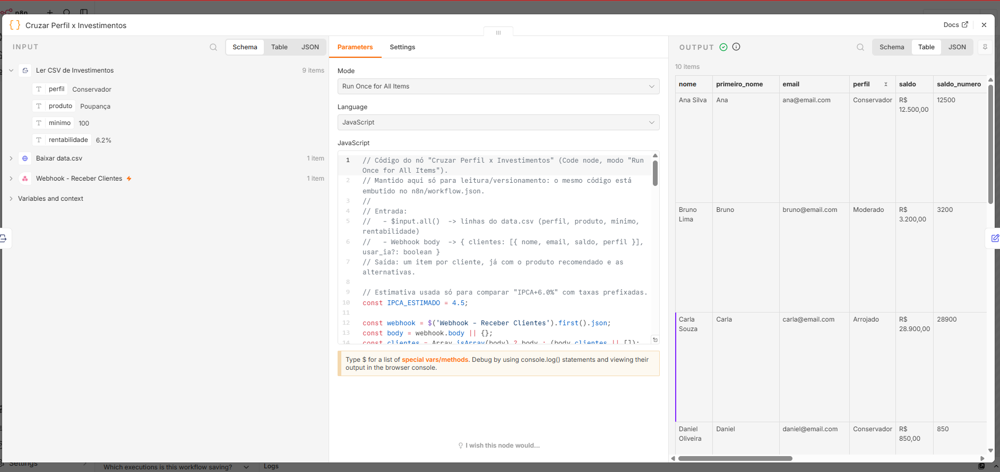
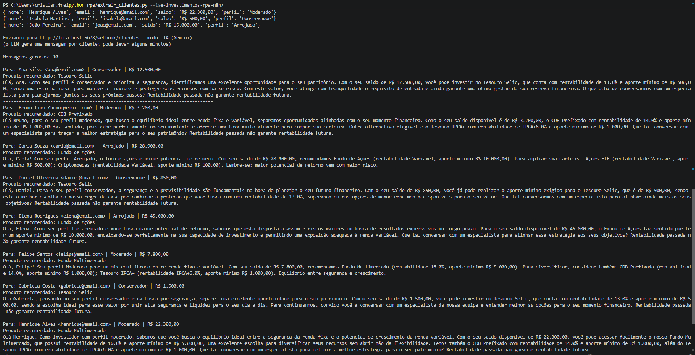
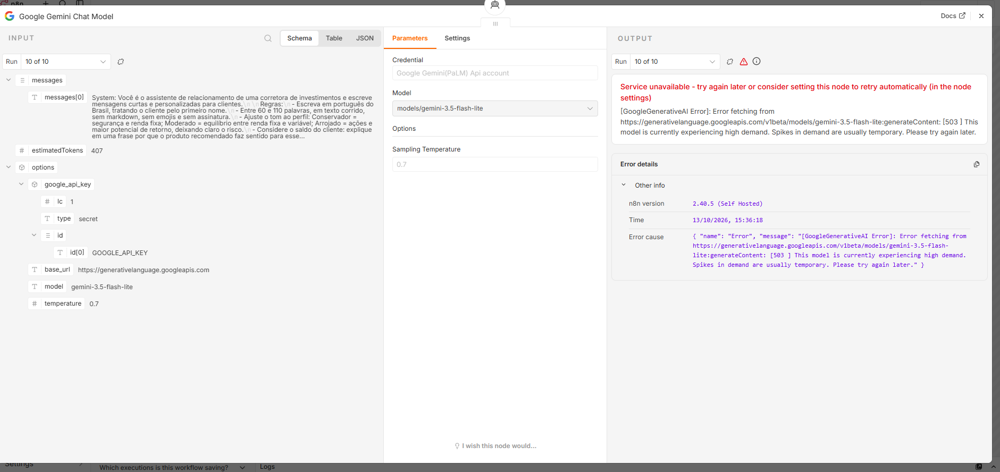

# Assistente de Investimentos com RPA + N8N + IA Generativa

Projeto final do desafio da DIO ([enunciado original](ENUNCIADO.md)). Um robô em Python lê os clientes de uma página web, envia os dados para um workflow no N8N, que cruza o perfil de cada cliente com a base de investimentos e devolve uma mensagem de recomendação personalizada — por template fixo (MVP) ou gerada pelo Google Gemini (desafio extra).

## Arquitetura



## Demonstração

**Workflow no N8N**, publicado:



**Modo estático (MVP):** o robô extrai os 10 clientes da página e recebe as 10 mensagens do N8N.



**Execução no N8N:** sucesso em 583 ms, com a contagem de itens em cada etapa (1 requisição → 9 produtos → 10 clientes). Na lista lateral aparecem também as execuções do modo IA (7 a 9 min) e os erros do início do desenvolvimento.



**Nó "Cruzar Perfil x Investimentos":** entrada do CSV, código e saída com um item por cliente.



**Modo IA (desafio):** mensagens únicas geradas pelo Gemini para cada cliente. Carla e Felipe receberam o template porque o Gemini estava sobrecarregado (fallback).



**Fallback na prática:** o Gemini respondeu `503 - high demand` para um cliente, e a execução terminou com sucesso mesmo assim.



## Estrutura

```
├── README.md                    # esta documentação
├── ENUNCIADO.md                 # enunciado original do desafio
├── requirements.txt
├── evidencias/                  # prints da demonstração
├── docs/
│   ├── index.html               # página de clientes (fonte do RPA)
│   └── data.csv                 # opções de investimento por perfil
├── rpa/
│   ├── extrair_clientes.ipynb   # notebook (Colab) com o envio ao webhook implementado
│   └── extrair_clientes.py      # mesmo robô em script, para rodar com N8N local
└── n8n/
    ├── workflow.json            # workflow exportado (importar no N8N)
    ├── cruzar_perfis.js         # código do nó "Cruzar Perfil x Investimentos" (legível)
    └── build_workflow.py        # gera o workflow.json a partir do .js
```

## Como executar

### 1. Subir o N8N

Local, com Docker:

```bash
docker run -d --name n8n -p 5678:5678 -e GENERIC_TIMEZONE=America/Sao_Paulo -e TZ=America/Sao_Paulo -v n8n_data:/home/node/.n8n docker.n8n.io/n8nio/n8n
```

Acesse http://localhost:5678. Também funciona no N8N Cloud.

### 2. Importar o workflow

No N8N: **Create workflow → menu `...` → Import from File →** `n8n/workflow.json`. Depois clique em **Publish** para ativar o webhook de produção (`/webhook/clientes`).

### 3. (Desafio) Configurar o Gemini

1. Gere uma chave gratuita em [Google AI Studio](https://aistudio.google.com/app/apikey).
2. No N8N, abra o nó **Google Gemini Chat Model → Credential → Create new** e cole a chave.
3. Salve e publique o workflow novamente.

Sem essa credencial o modo estático continua funcionando normalmente; só o modo IA falha.

### 4. Rodar o robô

```bash
pip install -r requirements.txt
python rpa/extrair_clientes.py        # mensagens estáticas (MVP)
python rpa/extrair_clientes.py --ia   # mensagens geradas pelo Gemini
```

Para N8N Cloud, defina a URL de produção do webhook antes: `N8N_WEBHOOK=https://<sua-instancia>.app.n8n.cloud/webhook/clientes`.

No **Google Colab**, abra `rpa/extrair_clientes.ipynb`, ajuste `N8N_WEBHOOK` e `USAR_IA` e execute. O Colab roda na nuvem e não alcança o `localhost` da sua máquina: use o N8N Cloud ou um túnel (`ngrok http 5678`).

## Exemplo de saída (modo estático)

```
Para: Ana Silva <ana@email.com> | Conservador | R$ 12.500,00
Produto recomendado: Tesouro Selic
Olá, Ana! Como seu perfil é Conservador, nosso foco é segurança e renda fixa. Com seu saldo de
R$ 12.500,00, recomendamos Tesouro Selic (rentabilidade 13.0%, aporte mínimo R$ 500,00). Outras
opções seguras para você: CDB Liquidez Diária (...); Poupança (...). Seu dinheiro protegido e
rendendo com tranquilidade.
```

| Cliente | Perfil | Saldo | Recomendado |
|---|---|---|---|
| Ana Silva | Conservador | R$ 12.500,00 | Tesouro Selic |
| Bruno Lima | Moderado | R$ 3.200,00 | CDB Prefixado |
| Carla Souza | Arrojado | R$ 28.900,00 | Fundo de Ações |
| Daniel Oliveira | Conservador | R$ 850,00 | Tesouro Selic |
| Elena Rodrigues | Arrojado | R$ 45.000,00 | Fundo de Ações |
| Felipe Santos | Moderado | R$ 7.800,00 | Fundo Multimercado |
| Gabriela Costa | Conservador | R$ 1.500,00 | Tesouro Selic |
| Henrique Alves | Moderado | R$ 22.300,00 | Fundo Multimercado |
| Isabela Martins | Conservador | R$ 500,00 | Tesouro Selic |
| João Pereira | Arrojado | R$ 15.000,00 | Fundo de Ações |

## Decisões técnicas

**Um único workflow, dois modos.** O webhook recebe `{"clientes": [...], "usar_ia": true|false}` e um nó **IF** escolhe o caminho. Assim o mesmo `workflow.json` entrega o MVP e o desafio, e o modo estático continua funcionando mesmo sem chave de IA.

**Webhook com resposta síncrona.** O nó Webhook usa *Respond: Using 'Respond to Webhook' node*, e as mensagens voltam para o próprio robô Python na resposta do POST. Isso fecha o ciclo RPA → N8N → RPA sem precisar de banco ou serviço de e-mail, e deixa a demonstração ponta a ponta visível no terminal.

**CSV lido em tempo de execução.** O workflow baixa o `data.csv` do GitHub Pages a cada execução (HTTP Request → Extract from File). Mudar produtos ou taxas no CSV muda as recomendações sem tocar no workflow.

**Cruzamento em um Code node.** A regra de recomendação precisa de três coisas que seriam trabalhosas em nós visuais: converter `"R$ 12.500,00"` em número, filtrar produtos cujo **aporte mínimo cabe no saldo** e ordenar por rentabilidade. A regra é:

1. Considerar só produtos do perfil do cliente com `minimo <= saldo`.
2. Recomendar o de **maior rentabilidade anual conhecida**. `IPCA+6.0%` é comparado usando uma estimativa de IPCA de 4,5% a.a. (constante `IPCA_ESTIMADO`).
3. Se nenhum tiver taxa numérica (renda variável, perfil Arrojado), recomendar o de **maior aporte mínimo** que o saldo comporta — o produto mais estruturado ao alcance do cliente.
4. Os demais elegíveis viram "alternativas".
5. Se o saldo não cobre nenhum mínimo, a mensagem sugere quanto falta para o produto mais acessível; perfil desconhecido recebe uma mensagem pedindo para refazer o questionário.

O código fica legível em `n8n/cruzar_perfis.js`; `build_workflow.py` o embute no `workflow.json` para os dois não divergirem.

**Templates estáticos (MVP).** Um nó **Set** monta a mensagem com um template por perfil, seguindo o enunciado: Conservador = segurança e renda fixa; Moderado = equilíbrio entre renda fixa e variável; Arrojado = ações e maior potencial de retorno, com alerta de risco.

**Agente de IA (desafio).** O nó **AI Agent** recebe os dados já cruzados (nome, perfil, saldo, produto recomendado, alternativas) e o **Google Gemini** (`gemini-3.5-flash-lite`) escreve o texto. Decisões do prompt:

- A *escolha* do produto continua determinística (Code node); o LLM só redige. Isso evita que o modelo invente produtos ou recomende algo fora do perfil.
- O system prompt proíbe inventar taxas, prazos ou promessas de ganho e exige o aviso "Rentabilidade passada não garante rentabilidade futura." — cuidado básico de comunicação no mercado financeiro.
- Tamanho (60–110 palavras), tom por perfil e texto sem markdown, pronto para e-mail ou WhatsApp.
- `temperature: 0.7` para variar o texto entre clientes sem perder o foco.
- Valores sempre em algarismos, como nos dados, e proibição de palavras como "garante" ao falar de rentabilidade. Esses dois pontos foram acrescentados depois que os primeiros testes mostraram valores por extenso e uma frase com tom de promessa.
- *Batch Processing* (1 cliente por vez, 6 s entre chamadas) e *Retry on fail* (3 tentativas, 5 s) para respeitar o limite de requisições por minuto do plano gratuito do Gemini, já que é uma chamada por cliente.

**Fallback para o template.** A mensagem estática é gerada *antes* do IF, para todos os clientes. Se o LLM falhar para um cliente mesmo após as tentativas (o nó do agente usa *On Error: Continue*), o nó "Formatar Resposta da IA" usa o template e marca `origem_mensagem: "template_fallback"`. Assim uma instabilidade do provedor não derruba a execução inteira nem deixa cliente sem mensagem. Isso foi necessário na prática: durante os testes o `gemini-2.5-flash` foi descontinuado para contas novas (404) e o `gemini-3.8-flash` ficou sobrecarregado (503).

**Modelo Flash-Lite.** Foi escolhido por estar disponível no plano gratuito e ter menos fila que o Flash. Mesmo assim cada mensagem leva dezenas de segundos, por isso o robô Python espera até 15 minutos no modo IA.

Gemini foi escolhido por ter plano gratuito no Google AI Studio. Trocar de modelo é só escolher outro na lista do nó **Google Gemini Chat Model** (a lista vem da própria conta), ou trocar o sub-nó por OpenAI, Anthropic, Ollama local etc.

**Por que isso é RPA.** O robô faz o que um humano faria: abre a página, lê a tabela e repassa os dados para outro sistema. É a abordagem usada quando não existe API, como em sistemas legados.

## Limitações e próximos passos

- As mensagens são devolvidas ao robô, não enviadas. O próximo passo natural é ligar a saída a um nó Gmail/WhatsApp/Slack.
- A estimativa de IPCA é fixa; poderia vir de uma API (ex.: Banco Central).
- O webhook não tem autenticação. Em produção, use *Header Auth* no nó Webhook.
